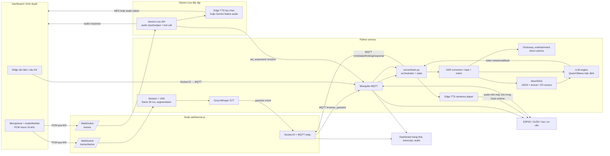

# Phân tích kiến trúc AI, Voice, RAG và Brain

Ngày rà soát: 16/10/2026. Phạm vi: mã nguồn trong `server/`, `web/`, `config/`, `data/`, `tests/`, `docs/` và cấu hình phụ thuộc. Đây là đánh giá tĩnh theo repository; không chạy dịch vụ/model/API trong lúc rà soát. Tình trạng “đã có” dưới đây nghĩa là có đường thực thi trong mã, không khẳng định đã nghiệm thu trên phần cứng thật.

## 1. Tổng quan kiến trúc

Moon có ba đường nhận tiếng nói và một đường nhập văn bản. Chúng hội tụ vào Brain chỉ ở các pipeline dành cho Brain. Gemini Live là pipeline độc lập, không đi qua `server/brain.py`, RAG hay Ollama. Vì vậy không nên hiểu hệ thống là một chuỗi Voice→Brain→RAG→LLM duy nhất.

### Giao tiếp và ranh giới

- **Browser voice Brain:** `web/public/live-talk.js` gửi PCM qua WebSocket `/transcribe/ws`; Node không xử lý audio ở đây mà nhận diện service Python qua `web/voice-bridge.js` (upstream `ws://127.0.0.1:8765/ws...`). Python `server/voice/runtime/session.py` phân đoạn tiếng nói rồi gọi Groq Whisper trực tiếp. Transcript/question được đưa lên client, rồi client phát event `brain_question`; Socket.IO chuyển câu chữ qua MQTT `moon/ai/browser_question` tới Brain.
- **Gemini Live:** browser gửi PCM tới `/live/ws`; `web/gemini-live-bridge.js` kết nối Gemini Live qua `@google/genai`. Bridge giữ API key ở Node. Gemini trả audio; chế độ Edge chuyển transcript câu trả lời sang `web/edge-tts.js` rồi gửi MP3 về browser, hoặc dùng audio native Gemini. Function `set_expression` gửi trạng thái mặt qua MQTT. Đây không gọi Brain hay RAG.
- **Text/dashboard/robot:** Socket.IO xử lý UI event và MQTT relay. MQTT dùng prefix `moon/`; Python Brain publish trạng thái, câu trả lời, cảm xúc/lệnh; Node chuyển tiếp MQTT sang dashboard. ESP32 nhận `moon/cmd/*`, gửi `moon/status`.
- **Brain / LLM:** gọi nội bộ Python theo module; LLM stream qua adapter REST tới Ollama mặc định. RAG chạy trong process, đọc JSON và cache embedding, không cần dịch vụ vector database.
- **Voice cục bộ/legacy:** `server/voice/runtime/local.py` cung cấp luồng microphone cục bộ/wakeword qua Groq STT; `server/brain.py` cũng còn các handler cho audio clip WebM/PCM qua MQTT. Các đường này tồn tại bên cạnh luồng dashboard mới và có thể tạo chồng lấn nếu bật sai cấu hình.

## 2. Phân tích module

### 2.1 Brain / orchestration và trạng thái

**File chính:** `server/brain.py`, `server/llm/brain_router.py`, `server/llm/engine.py`, `server/network/mqtt_bridge.py`, `server/network/topics.py`, `config/settings.py`.

**Vai trò và luồng thực thi**

1. `brain.py` khởi tạo bridge MQTT, đăng ký callback trạng thái robot, browser question/clip/audio, và chạy các worker vision riêng. Các state chính gồm `standby`, `listening`, `thinking`, `speaking`; cập nhật ra MQTT để dashboard/OLED phản ánh.
2. `_handle_wake_word` tuần tự xử lý trigger/câu hỏi, cập nhật thinking/topic, sửa transcript và phân loại topic. Có nhánh lệnh di chuyển trực tiếp và fast path từ vựng/giải trí để bỏ qua LLM.
3. Nhánh trả lời gọi `llm.chat_async`. Callback token gửi dần `moon/ai/response`, gom token theo dấu câu và đẩy từng câu sang `SentencePlayer`; khi provider còn tạo câu sau thì câu đầu đã có thể được tổng hợp/phát. Timeout LLM/TTS và `finally` dọn trạng thái, hủy phiên, dừng player.
4. `on_browser_question` là cầu nối cho transcript từ live browser: nhận văn bản đã STT, sau đó đưa vào pipeline xử lý Brain. Các handler clip/audio khác vẫn tồn tại cho browser push-to-talk hoặc mic qua MQTT.
5. `brain_router.py` kết hợp phân loại intent và prompt overrides để quyết định có buộc truy hồi kiến thức; `server/llm/engine.py` giữ lịch sử hội thoại trong RAM, tạo prompt, chọn fast paths, gọi provider và kiểm tra ngôn ngữ đầu ra.

**State và giao thức:** Python callback/thread/`threading.Event` và khóa cho phiên TTS; MQTT cho trạng thái/robot/dashboard; các sự kiện browser question qua MQTT. Không có một state store bền vững hoặc session ID hội thoại rõ ràng giữa client và Brain.

**Hiện trạng:** Brain pipeline có logic thực thi và test cho router/pipeline/provider. Các nhánh hành động trực tiếp, RAG, streaming, TTS và MQTT được code. Tuy nhiên đây là monolith điều phối nhiều trách nhiệm, cấu hình transport/legacy xen kẽ; không thể coi mọi đường micro đều cùng một state machine. Vision là process/queue riêng, có giao tiếp với Brain nhưng ngoài phạm vi phân tích chi tiết.

### 2.2 LLM

**File:** `server/llm/engine.py`, `server/llm/brain_router.py`, `server/llm/language.py`, `server/llm/pedagogy.py`, `server/llm/dictionary_router.py`, `server/llm/moon_tutor.py`, `server/llm_providers/ollama.py`, `server/llm_providers/gemini.py`, `config/settings.py`.

**Tech stack/model thực tế**

- Mặc định `LLM_PROVIDER="ollama"`, model cấu hình `qwen3.5:2b`, giới hạn output 128 token theo `config/settings.py`; README còn mô tả một biến thể `moon-tutor`/Q4 nên cần xác thực sự đồng bộ khi triển khai. `engine.py` có thể dùng Ollama, Gemini, DeepSeek/Groq tùy cấu hình và khả năng adapter.
- Ollama adapter dùng HTTP streaming `/api/chat`, giữ model `30m`, giới hạn context 2048, GPU offload và sampling options. Gemini text adapter dùng REST `streamGenerateContent` dạng SSE. Đây là adapter tự viết bằng `requests`, không thấy LangChain.
- Có prompt pedagogy/role-play, route intent, ưu tiên ngôn ngữ câu hỏi mới nhất, retry/kiểm tra ngôn ngữ và output grounded.

**Code walkthrough**

- `chat()` trong `engine.py`: chuẩn hóa câu hỏi/ngôn ngữ; kiểm tra một số fast path (ví dụ realtime/pedagogy/đáp án grounded); dựng messages qua `_get_messages`; gọi provider stream; thu câu trả lời, cập nhật lịch sử và các callback. `chat_async()` bọc luồng callback trong worker thread để Brain không block trong lúc provider phát token.
- `_get_messages()` ghép system prompt, hướng dẫn ngôn ngữ/role, context RAG nếu intent hoặc câu hỏi học tập yêu cầu, rồi lấy một cửa sổ lịch sử cuối. `_add_to_history()` giới hạn độ dài nhưng history là global process, không phân theo user/session.
- `_generate_response()`/`_stream_provider()` kết nối adapter được chọn; lỗi provider có fallback theo cấu hình. Provider exceptions được bắt ở một số tầng, nhưng lỗi/timeout giữa các callback, fallback và worker cần được quan sát đồng nhất.
- `brain_router.IntentRouter` tạo quyết định intent và `use_rag`, prompt override. `language.py` phát hiện ngôn ngữ trả lời, phát hướng dẫn strict retry nếu câu trả lời không khớp ngôn ngữ mong muốn.

**Hiện trạng:** chức năng LLM streaming, adapter Ollama/Gemini, prompt/route/ngôn ngữ đã được triển khai. Provider Gemini text không đồng nghĩa với Gemini Live. `quick()` phục vụ tác vụ ngắn như correction/caption. Tên model trong README, settings và một số preload của Node không thống nhất tuyệt đối; cần chọn một nguồn cấu hình duy nhất.

### 2.3 RAG / kho bài học

**File:** `server/llm/rag_engine.py`, `server/llm/precompute_embeddings.py`, `server/llm/engine.py`, `server/llm/data.json`, `data/data_v2.json`, `data/schema_v1.json`, `scripts/build_rag_index.py`, `tests/test_rag_*`, `tests/benchmark_rag_*`.

**Tech stack:** JSON corpus; Python, NumPy; tùy chọn `sentence-transformers` với `intfloat/multilingual-e5-small` (384 chiều) và PyTorch/CUDA. Không thấy ChromaDB, FAISS, Pinecone hay LangChain. Embedding cache `.npz` ở cạnh mã RAG.

**Code walkthrough**

- `MoonRAG.load_data()` chọn `data/data_v2.json` nếu tồn tại, nạp corpus, tạo trường chuẩn hóa và inverted index, dựng/load embeddings cache theo hash dữ liệu.
- `search()` dùng ba tầng ngắn mạch: (1) exact match từ khóa/từ/kanji/romaji; (2) lexical/fuzzy, token và tiếng Việt bỏ dấu; (3) cosine similarity trên E5, có ngưỡng `0.7961`. Nếu embedder vắng mặt hoặc lỗi kỹ thuật, fallback Jaccard; nếu vector model chạy thành công nhưng không qua ngưỡng thì trả rỗng (abstain), không ép fallback.
- `format_context_for_prompt()` đóng gói các field bài học thành `[LESSON DATA]`; prompt engine yêu cầu model không sửa/bịa các trường. `learning_display_info()` và `publish_learning_display()` hỗ trợ hiển thị nội dung học lên OLED.
- `engine.learning_context()` chỉ truy hồi khi bật RAG và có ý định học, hoặc router buộc `use_rag`; `grounded_learning_answer()` có thể trả lời trực tiếp các lookup từ vựng để tránh model nhỏ làm sai chữ Nhật.

**Hiện trạng:** retrieval hybrid và cache/benchmark/test regression đã có. Corpus là dữ liệu nhỏ, phù hợp một process và tra cứu cục bộ. Tầng vector có thể làm cold start lâu và phụ thuộc model/cache; claim thời gian <1 ms chỉ mô tả cosine trên embeddings đã có, không bao gồm encode query, nạp model, disk I/O hay contention GPU. Dữ liệu V1/V2 và mô tả số bài trong README cần xác nhận bằng việc đếm corpus trước khi công bố.

### 2.4 Voice: capture, STT, segmentation, TTS

**File:** `server/voice/runtime/session.py`, `server/voice/runtime/web.py`, `server/voice/runtime/local.py`, `server/voice/audio/segmentation.py`, `server/voice/audio/processing.py`, `server/voice/speech/transcription.py`, `server/voice/speech/validation.py`, `server/voice/wake/*`, `server/voice/tts.py`, `server/voice/edge_tts_cli.py`, cùng `web/voice-bridge.js`, `web/gemini-transcribe-bridge.js`, `web/gemini-live-bridge.js`, `web/edge-tts.js`, `web/fish-tts.js`, `web/public/live-talk.js`, `web/public/voice-worklet.js`.

**STT/capture**

- Browser capture chạy Web Audio/AudioWorklet, PCM mono 16 kHz, frame 30 ms; có giới hạn một microphone owner và pause/resume để tránh thu tiếng loa. Brain pipeline truyền frame theo WebSocket tới Python service.
- `Segmenter` dùng WebRTC VAD, RMS noise floor thích nghi, 10 frame pre-roll, 3/5 onset votes, silence endpoint và max utterance; clip đưa vào `asyncio.Queue(maxsize=3)`. Queue đầy thì báo lỗi và đóng socket để tránh xử lý âm thanh cũ.
- `Session.worker()` gọi Groq Whisper theo clip; với wakeword acoustic dùng Porcupine nếu có key/model, nếu không dùng Whisper wake path. Có epoch để loại audio cũ sau pause, timeout/wake gating và kiểm tra transcript. `transcription.py` đóng gói adapter Groq; cấu hình hiện đặt `STT_LANGUAGE="vi"`, model `whisper-large-v3-turbo`.
- `gemini-transcribe-bridge.js` là đường STT khác (Gemini streaming transcription) dùng ở các mode/wake của dashboard; không phải chính `Session` Groq path. `voice-bridge.js` proxy WebSocket browser đến Python service.

**TTS**

- Brain/local: `SentencePlayer` trong `server/voice/tts.py` tổng hợp câu nền, đưa audio vào queue phát tuần tự; có timeout tổng hợp, fallback callback, stop, speaking state và đồng bộ mic. Edge TTS neural online, chọn voice theo ngôn ngữ. Có module Fish TTS nhưng cấu hình/đường dùng là tùy chọn; không phải mặc định.
- Gemini Live: Edge mode chờ transcript câu trả lời Gemini rồi gọi Edge TTS tạo MP3; có thể fallback sang audio Gemini đã giữ trong bộ nhớ. Gemini Native phát audio trực tiếp. Đây là TTS/voice của pipeline Node/browser, không phải `SentencePlayer` Python.

**Hiện trạng:** capture, segmentation, wake, STT, streaming TTS và recovery có code/test tương đối rõ. Các provider cloud làm mất khả năng offline thực sự; Edge/Groq/Gemini phụ thuộc mạng/quota. Có nhiều transport cũ/nhánh thử nghiệm, vì vậy lựa chọn mode trong UI và cấu hình server cần được xem là một phần của deployment.

### 2.5 Gemini Live

**File:** `web/gemini-live-bridge.js`, `web/public/live-talk.js`, `web/public/voice-worklet.js`, `web/edge-tts.js`, `web/gemini-transcribe-bridge.js`.

Node mở WebSocket `/live/ws`, quản lý phiên Gemini Live và chuyển frame audio. Bridge xử lý response audio theo chunks, generation/cancel state, tool `set_expression`, playback-complete/failed từ browser và lựa chọn provider Edge hoặc Gemini Native. Browser quản lý microphone, audio decode/playback queue, interrupt và trạng thái UI. Chế độ Edge giữ response audio Gemini để fallback; do phải đợi transcript hoàn chỉnh rồi gọi TTS, first audio có thêm một vòng tổng hợp và audio có thể được giữ trong RAM đến khi hoàn tất.

**Hiện trạng:** đây là pipeline độc lập đã có bridge và test bridge không gọi API thật. Tính năng tool hiện quan sát được là biểu cảm OLED; không thấy bộ tool gọi lệnh di chuyển an toàn từ Gemini trong luồng này. Tài liệu và cấu hình cần phân biệt model Gemini Live, model Gemini Transcribe và model Gemini text.

## 3. Đánh giá và đề xuất

### Độ trễ và điểm nghẽn

1. **Brain browser path có nhiều hop tuần tự:** VAD chờ endpoint im lặng → Groq STT → event question về browser → MQTT → Brain → sửa transcript/phân loại, có thể gọi model quick → RAG/LLM → đợi câu đầu đủ dấu câu → Edge TTS → phát. `QUESTION_DISPLAY_SEC` cũng thêm pause cấu hình. Đoạn code có log wake→question và wake→first audio, nhưng không phải mọi hop đều có metric thống nhất.
2. **Sentence TTS giảm latency cảm nhận**, nhưng chỉ bắt đầu sau khi model tạo đủ câu; câu quá dài/thiếu punctuation làm TTS chờ lâu. Provider local Qwen có tốc độ phụ thuộc GPU/VRAM, context và preload. Node và Python có preload model riêng với cấu hình model/keepalive khác nhau, có thể gây lặp hoặc preload sai model.
3. **Gemini Live Native có đường phát trực tiếp**, nên thường ít bước hơn. Gemini Live + Edge TTS phải hoàn tất câu/transcript rồi mới tổng hợp; fallback còn giữ audio Gemini trong bộ nhớ.
4. **Cold start RAG** có thể tải E5 và tạo embeddings nếu cache chưa tồn tại/không hợp lệ; dù corpus nhỏ, model load là khoản đáng kể. Encode query vector cũng có thể tranh GPU với Ollama.
5. **Mạng và quota** là thành phần latency/availability chính: Groq STT, Gemini Live/Transcribe, Edge TTS, và tùy cấu hình LLM cloud. Retry/fallback cần timeout tổng và deadline theo lượt.

### Rủi ro thiết kế cần theo dõi

- **Context bị dùng chung:** `_conversation_history` và active role play trong engine là global process, không gắn session/user. Nhiều người dùng hoặc một phiên mới có thể nhận lịch sử phiên khác; `clear_history()` theo mic lifecycle không giải quyết concurrency đầy đủ.
- **Concurrency/cancel:** Brain gọi LLM qua thread và callback, TTS có worker riêng, MQTT có network thread; lock/event bảo vệ một số vùng nhưng callback publishing, timeout và callback muộn sau hủy vẫn cần kiểm chứng. Đặc biệt tránh callback cũ làm đổi state hoặc phát audio cho lượt mới.
- **Backpressure/bộ nhớ:** Live Gemini giữ chunks audio cho fallback; cần giới hạn tổng byte/thời gian và dọn ngay khi đóng/cancel. Các event MQTT base64 clip có thể phình payload; giới hạn message/topic và kích thước clip nên thống nhất.
- **Giao thức không có correlation ID:** response/thinking/state MQTT không mang session/turn ID nhất quán, dễ trộn câu trả lời nếu interrupt/new turn/đa tab. Mic lock UI hữu ích nhưng không thay thế idempotency ở backend.
- **Bảo mật và độ tin cậy:** API key được giữ phía backend theo thiết kế; cần tiếp tục tránh log body ngoại lệ chứa dữ liệu nhạy cảm. MQTT broker hiện localhost, không thấy auth/TLS trong cấu hình mặc định; phù hợp local dev hơn production.
- **Exception/fallback:** một số handler in lỗi rồi trả chuỗi rỗng hoặc fallback; UI có thể khó phân biệt không nghe rõ, quota, timeout và provider lỗi. Chuẩn hóa mã lỗi, timeout tổng, retry có giới hạn và metrics.
- **RAG grounding:** prompt ràng buộc không tự đảm bảo grounding. Ngưỡng semantic cần đánh giá theo từng ngôn ngữ/intent; tránh hiển thị kết quả truy hồi yếu như dữ kiện chắc chắn. Thay đổi corpus cần invalidation cache atomically.
- **Drift tài liệu/cấu hình:** README ghi một số tên module/model/đếm bài cũ (ví dụ `server/learning`, `llm.py`, `moon-tutor`), trong khi code hiện ở `server/llm`, `engine.py`, cấu hình `qwen3.5:2b`. Node preload cũng hard-code model khác chi tiết so với cấu hình Python. Đây là rủi ro vận hành đáng ưu tiên.

### Next steps theo thứ tự ưu tiên

1. **Chốt kiến trúc pipeline và cấu hình:** lập bảng mode UI→transport→STT→Brain/LLM→TTS; bỏ/đánh dấu legacy không dùng. Đưa tên Ollama model, endpoint, timeout và provider vào một nguồn config, xóa preload hard-code trùng.
2. **Thêm turn/session ID và context tách biệt:** truyền ID qua WebSocket, Socket.IO/MQTT và callback; quản lý history theo conversation với giới hạn token, TTL và reset rõ ràng. Khóa lượt để interrupt/hủy không ảnh hưởng lượt sau.
3. **Đo latency theo stage:** timestamps cho audio-end, STT-start/end, question-to-Brain, first LLM token, first complete sentence, TTS-start/end, first playback. Báo p50/p95 theo pipeline và ngôn ngữ; không chỉ log tổng.
4. **Thiết lập deadline/backpressure end-to-end:** giới hạn audio queue/clip bytes, Gemini buffered audio, kích thước MQTT; đặt timeout tổng theo lượt và hủy request upstream khi timeout/disconnect. Giới hạn số phiên đồng thời.
5. **Tối ưu latency cảm nhận:** tune endpoint silence theo mode; phát TTS khi có clause đủ an toàn thay vì chỉ câu dài; benchmark Qwen quant/model, context và GPU contention với E5; preload duy nhất khi backend khởi động.
6. **Gia củng cố RAG:** chạy benchmark multilingual có positive/negative theo intent; log tier/score/abstain; kiểm tra grounding trong câu trả lời; nạp embeddings cache trước khi nhận phiên thay vì cold path.
7. **Chuẩn hóa lỗi/quan sát:** error codes cho STT, LLM, TTS, MQTT; metric timeout/fallback/reconnect, không log API key/audio/transcript nhạy cảm ngoài chính sách retention.
8. **Cập nhật tài liệu và deployment:** đồng bộ README/docs với đường dẫn/model thực tế, ghi rõ dependency tùy chọn, MQTT security và điều kiện chạy local/cloud. Bộ test sẵn có bao phủ nhiều thành phần; chạy suite trên cấu hình mục tiêu trước khi thay đổi pipeline.

## 4. Danh mục kiểm tra chính

- Brain: `server/brain.py`, `server/llm/brain_router.py`, `server/network/mqtt_bridge.py`, `server/network/topics.py`.
- LLM/RAG: `server/llm/engine.py`, `server/llm/rag_engine.py`, `server/llm/language.py`, `server/llm/pedagogy.py`, `server/llm/dictionary_router.py`, `server/llm_providers/*`, `data/data_v2.json`.
- Voice: `server/voice/audio/*`, `server/voice/speech/*`, `server/voice/wake/*`, `server/voice/runtime/*`, `server/voice/tts.py`.
- Browser/Node: `web/server.js`, `web/voice-bridge.js`, `web/gemini-transcribe-bridge.js`, `web/gemini-live-bridge.js`, `web/public/live-talk.js`, `web/public/voice-worklet.js`, `web/edge-tts.js`.
- Kiểm thử liên quan: `tests/test_brain_router.py`, `tests/test_voice_session.py`, `tests/test_voice_stream_control.py`, `tests/test_ollama_llm_provider.py`, `tests/test_gemini_llm_provider.py`, `tests/test_rag_retrieval_regression.py`, `tests/test_rag_precompute.py`, `tests/test_pipeline.py` và các test bridge Node.
